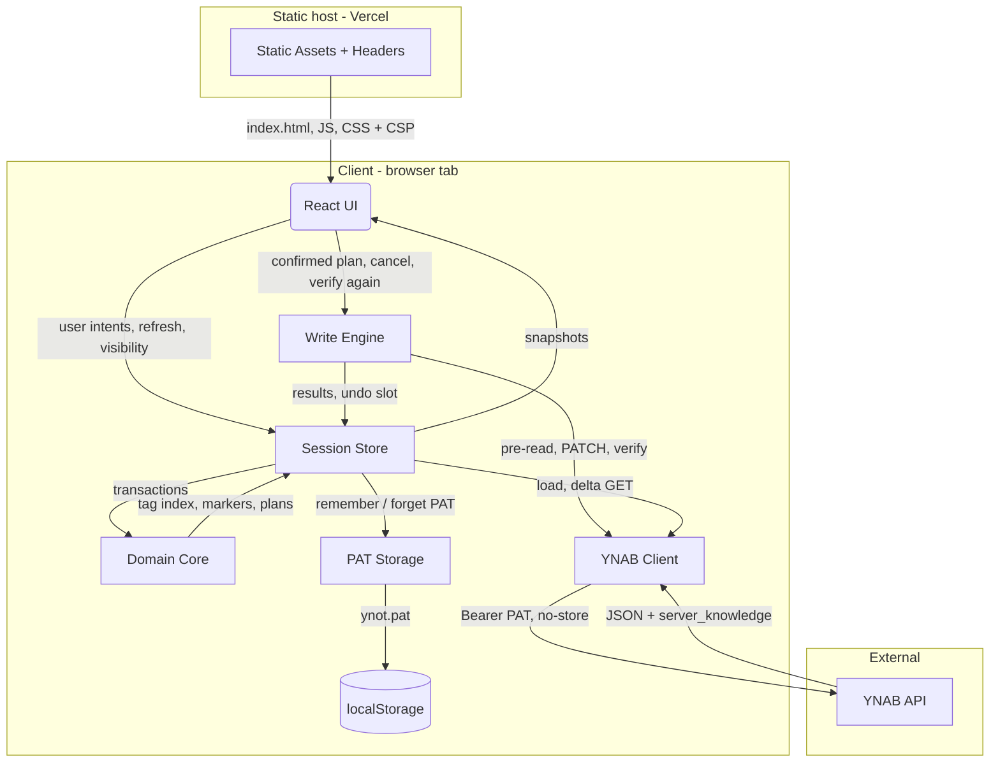

# Design Document: YNAB Tagging

## Overview

Ynot v1 is a static single-page app built with Vite+ (`vp`), React and TypeScript, deployed to Vercel on a dedicated subdomain. The browser talks straight to `https://api.ynab.com` with a Personal Access Token. The token lives inside one in-memory YNAB client object, and also in the origin's `localStorage` when the user ticks **Remember on this device**. Everything else exists only in page memory and in YNAB.

The code has four layers:

1. **Domain** (`src/domain/`): pure, framework-free TypeScript. It covers:
   - the hashtag grammar and Tag Identity
   - membership, Contributions and Tag Totals
   - the vocabulary and its markers
   - register filtering and memo rewriting
   - operation planning

   It makes no network calls, reads no clocks and imports no React, so tests can reach all of it.
2. **YNAB adapter** (`src/ynab/`): a small hand-written `fetch` client, typed from YNAB's pinned OpenAPI document. It covers initial loading, delta refreshes and batched memo writes. It also enforces the network boundary: only the YNAB origin, `no-store` caching, timeouts and error classification.
3. **Session runtime** (`src/session/`, `src/writes/`): one in-memory store that owns:
   - the connection and the Budget Session
   - refresh on return
   - the write engine and the undo slot
   - the one module allowed to touch `localStorage` (`patStorage.ts`)

   Ending a session (Disconnect or reload) drops the whole object graph. Switching budget drops the Budget Session and keeps the connection.
4. **UI** (`src/ui/`): React components built on React Aria Components. The layout is desktop-first with a phone layout. There is no URL routing, so no financial data can reach a URL.

The build is delivered in vertical slices. Slice 1 is a read-only tag reader, and it is the first usable version (see [Build slices](#build-slices)).

Out of scope, per the requirements:

- a backend, OAuth, or persistence beyond a Remembered PAT
- a service worker
- split-level writes and scheduled transactions
- analytics
- staged plans, queued writes, multi-step undo, and pause/resume
- automatic polling and an idle lock

## Goals / Non-Goals

**Goals:**

- Enforce the privacy boundary in code and deployment (Req 1, 2, 21.6):
  - YNAB is the only network destination.
  - The CSP fails closed.
  - API responses are never cached.
  - Financial data is held in memory only.
  - A PAT is stored only when the user opts in.
- Implement the grammar, identity, membership, Contribution, totals and marker rules once, as pure functions shared by the reader, the overview and every writer (Req 7–11, 14–15).
- Make every memo rewrite provably conservative: only tag spans and at most one adjacent whitespace character change, and nothing is ever truncated (Req 12–13).
- Keep each write safe with a few checks: re-read before writing, carry `approved`, verify afterwards, and on any failure stop, verify and report (Req 16–19).
- Ship a useful read-only slice first, then add tagging and vocabulary management in further slices.
- Make every control findable by role and name, for keyboards, screen readers and automated tools alike (Req 20).

**Non-Goals:**

- A server, server functions, proxy or edge middleware of any kind (Req 1.1).
- Offline support, a service worker or IndexedDB caching (Req 1.9, 22.4).
- Split-memo writes, selection of splits, or writing new splits (Req 22.2, 22.8).
- Charts, date-ranged totals, the reimbursement extension or other analytics (Req 22.5).
- Redo, multi-step undo, pause and resume, or queued operations (Req 22.7–22.8).
- Deep links or shareable URLs, because the URL must carry no financial data (Req 1.3).
- Detecting other tabs or apps that use the same PAT. YNAB's 429 response is the only authority on quota.

## Decisions

### Decision 1: Vite+ toolchain with React and TypeScript

**Outcome**: Build a client-only single-page app with React 19 and strict TypeScript on the Vite+ toolchain (`vite-plus`, `vp` CLI).

- **Package management:** pnpm, pinned through `packageManager`, in a single package.
- **Node:** 24 LTS, pinned in `engines` and in Vercel, so `scripts/*.ts` run directly with Node's built-in type stripping.
- **Entry points:** `vp dev`, `vp build` (Rolldown), `vp test` (Vitest), `vp check` (Oxfmt, Oxlint and type checks), `vp preview` and `vp run` are the only ones.
- **Configuration:** all tool configuration lives in one `vite.config.ts`.

**Reasoning**: Req 1.1 and 1.7 need a purely static bundle that runs under a CSP forbidding inline and evaluated scripts. Vite's production output emits only external module scripts and extracted CSS. One toolchain and one config file cover formatting, type-aware linting (including the storage ban in Data Models), type checking and tests. The owner's other projects already use React, TypeScript, Vitest, Oxlint and pnpm.

**Risks**: Vite+ is young and in beta, so the build pins its version exactly. `vp preview` must honour `preview.headers`, and the first build task verifies this. If it does not, the end-to-end tests serve `dist/` through a small static server that applies the `vercel.json` headers.

**Alternative Options**:
- **Plain Vite** with separate Vitest, Oxlint and Prettier configs: more mature, but more config to keep in step.
- **Next.js static export:** it injects inline bootstrap scripts, which conflicts with a strict CSP.

### Decision 2: Vercel static hosting, with headers from `vercel.json`

**Outcome**: Deploy `dist/` as a static Vercel project on a dedicated subdomain.

- **Headers:** CSP and security headers are declared in `vercel.json`.
- **Vercel features:** Web Analytics, Speed Insights and the preview toolbar are disabled.
- **Origins:** the production domain is the only origin for real use, and its hostname is deployment configuration, not code (Req 1.5).
- **Previews:** preview deployments stay behind Vercel Deployment Protection.

**Reasoning**: The owner already uses Vercel, and `vercel.json` headers are version-controlled beside the code. `vp preview` reads the same file, so local end-to-end tests run under the production CSP. A dedicated origin matters more now that a Remembered PAT lives in that origin's storage (ADR 0006).

**Alternative Options**: Cloudflare Pages, rejected only because it would add a new account and workflow.

### Decision 3: Pure domain core, imperative shell

**Outcome**: All rules for tags, Contributions, totals, markers, filtering, memo rewriting and planning live in `src/domain/` as pure functions over plain data. React components and the write engine only call them.

**Reasoning**:
- **Testability:** the grammar and rewrite rules carry the invariants that protect the user's prose, and those are best checked with fast-check properties, which is only practical without I/O.
- **One identity contract:** it guarantees Req 8.3, because every consumer imports the same `tagIdentity`.

**Alternative Options**: Logic spread through hooks and components, which is simpler at first but defeats both goals.

### Decision 4: Tag Identity is NFC plus default lowercase

**Outcome**: `tagIdentity(text) = text.normalize('NFC').toLowerCase()`.

**Reasoning**: Req 8.1 now asks for exactly this (ADR 0004 amendment, decision 11). `String.prototype.toLowerCase` applies Unicode's default lowercase mapping and does not depend on locale. It is deterministic within a session, which is all Req 8.3 needs, because identity is never stored or sent anywhere. For the owner's English tags it agrees with full case folding.

**Alternative Options**: A bundled Unicode 17 `CaseFolding.txt` table (the previous design). It is more correct for `ß` and final sigma, but costs a generator, a generated file and cross-browser identity tests.

### Decision 5: A hand-written YNAB client, typed from a pinned OpenAPI document

**Outcome**: Types are generated with `openapi-typescript` (a dev dependency with no runtime code) from a committed copy of YNAB's OpenAPI document (v1.86.0). About 200 lines of hand-written code in `src/ynab/client.ts` perform the requests.

**Reasoning**: The client must:
- assert the destination origin
- force `cache: 'no-store'`, `credentials: 'omit'` and `referrerPolicy: 'no-referrer'`
- apply a 35-second abort timeout
- classify failures (Req 1.4, 1.11, 18.1)

A tiny client keeps those guarantees auditable. Bundled dependencies are trusted code (Req 1.10), so fewer is better.

**Alternative Options**: The official `ynab` JavaScript SDK, which adds bundled runtime code and hides the fetch options.

### Decision 6: A delta read is the pre-write re-read and the verification

**Outcome**: The re-read before each write batch, and the verification after it, are each a single transactions delta request (`last_knowledge_of_server`), not per-transaction `GET`s.

**Reasoning**: A delta returns every transaction changed since the session's knowledge cursor, so anything absent is unchanged. One request re-reads the whole scope (Req 17.1) within the 200 requests/hour limit.

**Alternative Options**: A `GET /transactions/{id}` per planned transaction, which is exact but spends the quota on one large rename.

### Decision 7: Refresh on demand and on return

**Outcome**: There is no timer. Refresh runs in three cases:
- when the user presses Refresh
- when the tab becomes visible (`visibilitychange`)
- when the user confirms an Impact Preview (Req 4.1, 4.3, 4.6)

Each refresh is one transactions delta request. Accounts and categories are re-read on a manual Refresh and whenever a delta references an unknown account or category ID. No refresh starts while a Write Operation runs (Req 4.4).

**Reasoning**:
- **Who edits:** one person editing their own budget. The usual change is "I edited in YNAB, then switched back to Ynot", which the return-to-tab check covers.
- **Safety without polling:** the confirm-time re-plan and the per-batch pre-read already keep writes safe.
- **Quota:** usage is driven by the user, at a few requests per minute at most, so no request budget is needed.

**Alternative Options**: 60-second polling with a request budget (the previous design), rejected as machinery without a matching need (decision 9).

### Decision 8: Writes stop, verify and report

**Outcome**: On any write failure (a non-success response, a 200 whose returned memo is not `after`, a network loss, a timeout or a 429), the engine:
1. sends nothing further for that operation;
2. runs one delta verify;
3. classifies every item in scope as `done`, `unchanged` or `conflict`.

Continuing is a fresh plan of what remains, built from the Operation Results (Req 6.7, 18.7). A final delta verify runs after the last batch even when every response looked correct, so the results and the undo slot reflect what YNAB actually holds.

**Reasoning**: This is ADR 0007. Batch splitting, pause and Resume, persistent cancel, kind-change detection and remaining-work tracking all automated recovery from rare events. None of them added protection against memo loss. A re-run is safe because planning excludes transactions that already carry the change, and the recheck skips anything that moved.

**Alternative Options**: The previous pause/Resume state machine. That includes Decision 8's batch splitting, which isolated one over-long memo from 49 valid ones at the cost of about 12 requests and a recursive splitter. Under this design such a batch is verified, and the unchanged items return to review, where the fit check runs again.

### Decision 9: No URL routing; view state lives only in memory

**Outcome**: The app is served at a single path. Views, the Register scope, the open tag and filters are in-memory state, and the history API is never used.

**Reasoning**: Req 1.3 forbids financial data in URLs, and account names, tag spellings and search text all count.

**Alternative Options**: A hash router carrying opaque IDs. Even opaque IDs would reach browser history.

### Decision 10: React Aria Components for accessible primitives

**Outcome**: The UI is built on `react-aria-components`: GridList, Table, ListBox, ComboBox, Dialog, Toast, Tabs and Checkbox, styled with CSS Modules and system fonts. Long lists use `@tanstack/react-virtual`.

**Reasoning**:
- **Roles and names:** Req 20.2 needs every control and status to carry a semantic role and accessible name. React Aria supplies these by default, and the end-to-end tests rely on them through `getByRole`.
- **CSP:** both libraries run with no inline scripts or `eval`, and CSS Modules compile to external stylesheets.

**Alternative Options**: Radix UI, which has no grid or virtualised-collection primitives.

### Decision 11: Recompute derived indexes in full, with memoised memo parsing

**Outcome**: After any data change (load, delta, write), the Tag Index, markers and register counts are recomputed from the whole transaction set. Memo parses are cached in a `Map<string, ParsedMemo>` keyed by raw memo text.

**Reasoning**: Budgets have thousands to tens of thousands of transactions, and a linear pass with cached parses takes milliseconds. Full recomputation makes Property 18 (a delta-merged state matches a fresh full read) true by construction.

**Alternative Options**: Incremental index maintenance per delta, which creates a second code path whose bugs would silently skew Tag Totals.

### Decision 12: A remembered PAT lives behind one module

**Outcome**: `src/session/patStorage.ts` is the only code that touches `localStorage`. It reads, writes and deletes one key, `ynot.pat`. Lint bans web-storage globals everywhere else.

**Reasoning**: ADR 0006 and Req 2.9–2.10. One module with three functions keeps the storage surface easy to audit and test. The CSP and the absence of third-party scripts make it harder for foreign script to reach the origin, but script that does run there can read the stored token. That residual risk is accepted by opting in.

**Alternative Options**:
- `sessionStorage`: it would not survive closing the tab, so it removes little friction.
- IndexedDB: more machinery for one string.

## Architecture

### Runtime Component Flow Diagram



The static host serves only public assets and never receives the PAT or financial data. Every YNAB request goes through `YnabClient`.

### Session lifecycle

1. **Connect**: either the user pastes a PAT (with `Remember on this device` unticked by default), or a Remembered PAT is found on start-up. `YnabClient` is created, and `GET /plans?include_accounts=false` both validates the token and lists plans. If the user ticked Remember, the PAT is saved only after this call succeeds (Req 2.9, 3.1, 3.7–3.8). A 401 deletes any Remembered PAT and explains why (Req 2.10).
2. **Choose Budget**: a new `BudgetSession` is created with its own `AbortController`. Three requests run in parallel: `GET /plans/{id}/accounts`, `GET /plans/{id}/categories` and `GET /plans/{id}/transactions?since_date=<first_month>`. Until all three succeed, the UI shows loading state and no vocabulary or totals. A failure offers Retry and Disconnect (Req 3.2, 3.6–3.7).
3. **Browse**: the domain derives the Tag Index, the markers and, from slice 2, the register.
4. **Refresh**: per Decision 7. A delta is merged into the transaction map: upsert by ID, drop `deleted` transactions, and for each returned parent, replace its subtransactions with the non-deleted ones. Derived state is then recomputed (Req 3.5, 4.5).
5. **Switch budget**: the Budget Session's controller is aborted and the session is dropped. The store then returns to `choosingBudget` with a fresh plan list, keeping the client and any Remembered PAT. This is blocked while a Write Operation is unfinished or unverified (Req 3.9–3.10).
6. **End**: Disconnect deletes the Remembered PAT, disposes the client and drops the session. Reload or tab closure drops the session but leaves a Remembered PAT. A sent request may still land in YNAB (Req 2.2, 2.6–2.7).

**Stale-result guard**: every request made for a Budget Session passes that session's `signal`. The store applies a result only if the `BudgetSession` object that issued it is still the current one (reference equality). A response that was already resolving when the session ended is therefore discarded. Applying a result is atomic: there are no partial merges.

### Write flow

```text
Plan (domain) ─▶ Impact Preview ─▶ Confirm
  confirm-time refresh: delta read, merge, replan(request)
     planDiffers → replace the preview, show "changed since you reviewed it", write nothing (Req 4.6)
  fixed scope = confirmed plan's changes
  for each batch (≤50):
     [cancel requested?] → stop
     delta pre-read → recheck each item: gone | memo ≠ before | replanned after ≠ after → conflict (with reason)
     PATCH remaining items {id, memo: after, approved: current.approved}
        200 and every returned memo = after → continue
        anything else → stop
  verify: one delta read → classify every item still pending or sent
        memo = after → done · memo = before → unchanged · otherwise or deleted → conflict
        verify read fails → operation is unverified: Unknown Outcome, Verify again, writes blocked
  results → undo slot = this operation's done changes → clear selection
```

### Build slices

| Slice | Delivers | Main modules |
|---|---|---|
| **1. Read-only tag reader** (first usable) | Connect with optional remember, budget choice, full load, refresh, Tag Overview, Tag reader with Contributions and transfer pairs, warning markers | `domain/grammar`, `domain/tags`, `ynab/*`, `session/store`, `session/patStorage`, UI: `ConnectScreen`, `BudgetPicker`, `AppShell`, `TagOverview`, `TagRail`, `TagReader` |
| **2. Register and tagging** | All accounts and per-account Register, filters, selection, tag picker, apply/remove, write engine, Operation Results, undo last | `domain/register`, `domain/memo`, `domain/operations`, `writes/*`, UI: `AccountRail`, `RegisterToolbar`, `RegisterGrid`, `TransactionInspector`, `SelectionBar`, `TagPicker`, `ImpactPreview`, `OperationResults` |
| **3. Vocabulary management** | Rename, merge-on-rename and delete from the Tag reader, and near-duplicate marker actions | `domain/operations` (rename/merge/delete), UI: `RenameDialog`, `TagReader` header actions |
| **4. Release** | Vercel project, production headers check, live walkthroughs | `vercel.json`, release checklist |

The contract checks (see Testing Strategy) run before slice 2 writes anything.

### Layer Placement

| Concern | Layer | Location |
|---|---|---|
| Hashtag grammar, Tag Identity, tag text validation | Domain | `src/domain/grammar/` |
| Membership, Contributions, Canonical Spelling, Tag Totals, transfer pairs | Domain | `src/domain/tags/tagIndex.ts` |
| Near-duplicate and single-use markers | Domain | `src/domain/tags/markers.ts` |
| Register scope, filters, search, counts | Domain | `src/domain/register/` |
| Memo rewriting (apply/remove/rename) and fit check | Domain | `src/domain/memo/` |
| Operation planning, recheck, undo planning | Domain | `src/domain/operations/` |
| HTTP client, network boundary, error classification | YNAB adapter | `src/ynab/client.ts`, `src/ynab/errors.ts` |
| Initial load, mapping, delta merge | YNAB adapter | `src/ynab/load.ts`, `src/ynab/map.ts`, `src/ynab/delta.ts` |
| Generated API types | YNAB adapter | `src/ynab/openapi.generated.ts` (from `openapi/ynab-1.86.0.yaml`) |
| Session store, Budget Session, refresh on return | Session runtime | `src/session/store.ts`, `src/session/refreshOnReturn.ts` |
| Remembered PAT | Session runtime | `src/session/patStorage.ts` |
| Write engine, undo slot | Session runtime | `src/writes/` |
| Screens, rails, overview, register, reader, dialogs | UI | `src/ui/` |
| Deployment headers | Deployment | `vercel.json` |
| Fake YNAB for tests | Test | `test/fakeYnab.ts` |
| End-to-end, accessibility and boundary tests | Test | `e2e/` |

## Components and Interfaces

### `src/domain/grammar/parseMemo.ts`

```typescript
export interface TagToken {
  /** Index (UTF-16) of the first `#`, including extra markers. */
  readonly markerStart: number;
  /** Index just after the last consecutive `#` marker. */
  readonly textStart: number;
  /** Index just after the tag text, after trailing punctuation is trimmed. */
  readonly textEnd: number;
  /** Tag text as written, without markers. */
  readonly raw: string;
  /** NFC form of `raw`; the unit of spelling comparison. */
  readonly spelling: string;
  readonly identity: TagIdentity;
}

export interface ParsedMemo {
  readonly tokens: readonly TagToken[];
  /** Memo text with tag spans removed by the gap rule and `\#` shown as `#`. Display only. */
  readonly prose: string;
}

export function parseMemo(memo: string | null): ParsedMemo;
```

The parser walks the memo by code point:

1. A `#` is a candidate when it sits at the start of the memo, or when the previous code point is neither `\` nor in `\p{L}` or `\p{N}`. If the previous code point is a combining mark (`\p{M}`), the test applies to the base character of its sequence, so decomposed `é#tag` is rejected exactly like precomposed `é#tag` (Req 7.1). A mark with no base character is treated as the memo start.
2. Consecutive extra `#` markers are consumed.
3. The token runs to the next `\p{White_Space}` or the end of the memo.
4. Trailing `\p{Po}`, `\p{Pe}` and `\p{Pf}` are trimmed.
5. The token is rejected if the result is empty or entirely `\p{Nd}`.

`null` and `""` yield no tokens (Req 7.1–7.9).

### `src/domain/grammar/identity.ts`

```typescript
export type TagIdentity = string & { readonly __brand: 'TagIdentity' };

/** NFC, then the default Unicode lowercase mapping. Locale-independent (Decision 4). */
export function tagIdentity(text: string): TagIdentity;

/** Validates user-entered tag text for apply/rename: exactly one token, whole string, no trimming. */
export function validateTagText(text: string):
  | { ok: true; spelling: string }
  | { ok: false; reason: 'empty' | 'digitsOnly' | 'whitespace' | 'trailingPunctuation' | 'marker' };
```

`validateTagText` guarantees that a written tag reads back as exactly the spelling entered (Req 12.2, 12.11, 13.9). It accepts text with or without one leading `#`, and rejects anything `parseMemo` would not read back as a single whole token.

### `src/domain/tags/tagIndex.ts`

```typescript
export interface TagIndex {
  readonly byIdentity: ReadonlyMap<TagIdentity, TagEntry>;
  /** Transaction ID → identities it is a member of. */
  readonly membership: ReadonlyMap<TransactionId, ReadonlySet<TagIdentity>>;
}

export interface TagEntry {
  readonly identity: TagIdentity;
  readonly canonicalSpelling: string;
  /** Spelling → distinct Transactions carrying it (parent or split) and the earliest date among them. */
  readonly spellings: ReadonlyMap<string, { transactionCount: number; earliestDate: IsoDate }>;
  readonly members: readonly Member[];
  readonly parentMembers: ReadonlySet<TransactionId>;     // writable
  readonly splitOnlyMembers: ReadonlySet<TransactionId>;  // read-only
  readonly splitOccurrenceCount: number;                  // occurrences in split memos (unreachable by writes)
  readonly total: TagTotal;
}

export interface Member {
  readonly transactionId: TransactionId;
  readonly source: 'parent' | 'splits';
  /** Contributing amounts: [parent amount], or the amount of each tagged split line. */
  readonly contributingAmounts: readonly { subtransactionId: string | null; amount: number }[];
  readonly contribution: number; // sum of contributingAmounts
}

export interface TagTotal {
  readonly netMilliunits: number;
  readonly outflowMilliunits: number; // sum of negative contributing amounts, ≤ 0
  readonly inflowMilliunits: number;  // sum of positive contributing amounts, ≥ 0
  readonly memberCount: number;
  readonly transferPairs: readonly TransferPair[];
}

export interface TransferPair { readonly a: TransactionId; readonly b: TransactionId; }

export function buildTagIndex(
  transactions: ReadonlyMap<TransactionId, Transaction>,
  parse: (memo: string | null) => ParsedMemo,
): TagIndex;
```

The rules this index implements:

- **Membership** is the union of identities from the parent memo and every non-deleted subtransaction memo, and it is a set (Req 9.1–9.2).
- **Contribution** (Req 10.1–10.3, ADR 0005 amendment):
  - If the identity occurs in the parent memo, the contributing amounts are `[parent.amount]`.
  - Otherwise they are the `amount` of each non-deleted subtransaction whose memo carries the identity.
  - A subtransaction that carries the tag twice counts once.
- **Totals**: `net` is the sum of member contributions. `outflow` and `inflow` partition the contributing amounts by sign, and `memberCount` is the number of members.
- **Canonical Spelling** has the greatest `transactionCount`, then the earliest `earliestDate`, then the lowest code-point order (Req 8.4–8.7).
- **Transfer pairs**: each parent ID and each subtransaction ID is mapped to its parent transaction. Two members form a pair when a `transfer_transaction_id` on one of them, whether on the parent or on a subtransaction, resolves to the other (Req 10.5–10.6).
- **Outside-account count** (Req 10.7, 16.3) is computed by the UI from `members` and the Register's current account; it is not stored in the index.

### `src/domain/tags/markers.ts`

```typescript
export interface TagMarkers {
  /** Other identities sharing this identity's near-duplicate key, sorted by code point. */
  readonly nearDuplicateOf: readonly TagIdentity[];
  readonly singleUse: boolean;
}

/** Remove literal '-' and '_'. */
export function nearDuplicateKey(identity: TagIdentity): string;
export function deriveMarkers(index: TagIndex): ReadonlyMap<TagIdentity, TagMarkers>;
```

- **Near-duplicates** are every pair of distinct identities that share a nonempty key. Detection includes tags found only in split memos (Req 15.1–15.4, 15.9).
- **Single-use** means `memberCount === 1` (Req 14.2).
- **Order**: the UI always shows the near-duplicate marker before the single-use marker (Req 14.3).
- **Advisory only**: markers create no plan and no write (Req 14.5).

### `src/domain/register/register.ts`

```typescript
export type RegisterScope = { kind: 'account'; accountId: AccountId } | { kind: 'all' };

export interface RegisterFilters {
  readonly search: string;
  readonly categoryIds: ReadonlySet<CategoryId>;
  readonly categoryGroupIds: ReadonlySet<CategoryGroupId>;
  readonly statuses: ReadonlySet<'uncleared' | 'cleared' | 'reconciled'>;
  readonly tag: TagIdentity | null;
}

export interface RegisterView {
  readonly rows: readonly RegisterRow[];          // date desc, then id; complete history of the scope
  readonly matchingCount: number;
  readonly totalCount: number;
  readonly tagFacetCounts: ReadonlyMap<TagIdentity, number>; // within scope, after the non-tag filters
  readonly scopeCounts: ReadonlyMap<'all' | AccountId, { matching: number; total: number }>;
}

export function buildRegister(input: {
  transactions; accounts; categories; index: TagIndex; scope: RegisterScope; filters: RegisterFilters;
}): RegisterView;
```

- **Search** lowercases the query and matches it against the lowercased payee, account, category, category group and prose memo text of the parent and its splits.
- **Category and category-group facets** also match split children.
- **Tag facet counts** are computed within the scope against the search, category, category-group and status filters. Because the tag facet selects one tag at a time, a facet's count equals the rows shown when it is selected (Req 5.4–5.5, 5.9).
- **All accounts** rows carry the account name (Req 5.12).

### `src/domain/memo/rewrite.ts`

```typescript
export const MEMO_LIMIT_CODE_POINTS = 500;

export function applyTag(memo: string | null, spelling: string): string;
export function removeIdentity(memo: string | null, identity: TagIdentity): string | null;
export function renameIdentity(memo: string | null, from: TagIdentity, toSpelling: string): string | null;
export function fits(memo: string | null): boolean; // [...memo].length ≤ 500
```

Rewrite rules. Every function works on raw memo text, touches only tag spans, and processes tokens from right to left.

**Apply.** An empty or `null` memo becomes `#spelling`. Otherwise the result is `memo + " #" + spelling`, with nothing reordered (Req 12.2).

**Remove a span `[markerStart, textEnd)`.** Let L be the whitespace run immediately before the span and R the run immediately after it.

| Where the span sits | Whitespace to drop |
|---|---|
| At the memo start, with R nonempty | R's first code point |
| At the memo end, with L nonempty | L's last code point |
| Between whitespace on both sides | L's last code point, unless L's last code point is a line break and R's first is not; then R's first |
| In the middle, with whitespace on one side only | nothing extra |

Trailing punctuation that was trimmed from the token stays in place, so `shop #Tag · Club` becomes `shop · Club` (Req 12.4).

**Rename** replaces the text `[textStart, textEnd)` of each matching token and keeps its markers.
- **Merge:** when the source and target are **distinct** identities and the parent memo already contains the target, the source occurrence is removed instead of renamed, so a merge never creates a repeat (Req 13.2–13.3).
- **Same identity:** a target with the **same** identity as the source (for example `#tax` to `#Tax`) is never planned. `planRename` throws, and `RenameDialog` shows the reason inline, because respelling one identity is deferred (Req 13.4, 13.9).

**Empty results.** A rewrite whose result is empty returns `null`, never `""`. The rewriters never compare memos; `recheck` and verification do, exactly.

### `src/domain/operations/plan.ts`

```typescript
export type OperationKind = 'apply' | 'remove' | 'rename' | 'merge' | 'delete' | 'undo';

export interface PlannedChange {
  readonly transactionId: TransactionId;
  readonly accountId: AccountId;
  readonly before: string | null;   // raw memo at planning time
  readonly after: string | null;
}

/** The structured intent a plan was built from, so it can be re-planned. */
export type PlanRequest =
  | { kind: 'apply'; ids: readonly TransactionId[]; spelling: string }
  | { kind: 'remove'; ids: readonly TransactionId[]; identity: TagIdentity }
  | { kind: 'rename'; from: TagIdentity; toSpelling: string }   // yields a rename or merge plan
  | { kind: 'delete'; identity: TagIdentity }
  | { kind: 'undo'; source: UndoSlot };

export type Exclusion =
  | { reason: 'alreadyTagged'; transactionId: TransactionId }
  | { reason: 'splitOnly'; transactionId: TransactionId; splitOccurrences: number }
  | { reason: 'overLength'; transactionId: TransactionId; wouldBe: number }
  | { reason: 'changedSince'; transactionId: TransactionId }   // undo: memo no longer equals confirmedAfter
  | { reason: 'noChange'; transactionId: TransactionId };

export interface OperationPlan {
  readonly kind: OperationKind;
  readonly request: PlanRequest;
  readonly label: string;                    // display only, e.g. "Rename #HomeRepair → #Home-Repair"
  readonly changes: readonly PlannedChange[];
  readonly exclusions: readonly Exclusion[];
  readonly unreachableSplitOccurrences: number;
  readonly remainsInVocabularyAfter: boolean; // old identity survives in splits
}

/** Requires a valid spelling from validateTagText; throws on invalid input. */
export function planApply(state: DomainState, ids: readonly TransactionId[], spelling: string): OperationPlan;
export function planRemove(state: DomainState, ids: readonly TransactionId[], identity: TagIdentity): OperationPlan;
/** Kind 'merge' when a distinct target identity exists. Requires a valid spelling; throws on invalid input. */
export function planRename(state: DomainState, from: TagIdentity, toSpelling: string): OperationPlan;
export function planDelete(state: DomainState, identity: TagIdentity): OperationPlan;
export function planUndo(state: DomainState, source: UndoSlot): OperationPlan;
export function replan(state: DomainState, request: PlanRequest): OperationPlan;
export function planDiffers(a: OperationPlan, b: OperationPlan): boolean; // kind, change IDs, befores, afters, exclusions
export function recheck(change: PlannedChange, request: PlanRequest, current: Transaction | undefined, state: DomainState):
  'ok' | 'gone' | 'memoChanged' | 'replanDiffers';
```

- **Apply** excludes transactions that already carry the identity in any memo (Req 12.3).
- **Remove, rename, merge and delete** reach only `parentMembers`. Split-only members are listed as exclusions, and surviving split occurrences are counted (Req 9.3–9.5, 13.1, 13.8).
- **Over-length results** are excluded and never truncated (Req 12.7).
- **Validation in the domain**: `planApply` and `planRename` call `validateTagText` themselves and throw on invalid text. The UI shows the reason inline before it ever calls them (Req 12.11, 13.9). `replan` therefore can never produce a plan for invalid text.
- **Undo** builds a change restoring `before` for each slot entry whose current memo equals `confirmedAfter`. Every other entry becomes a `changedSince` exclusion (Req 19.2–19.3).
- **`recheck`** compares the re-read transaction against the confirmed change (Req 17.1–17.3):
  - `gone` if it was deleted;
  - `memoChanged` if its memo ≠ `before`;
  - `replanDiffers` if planning `request` for this one transaction against the current state gives a different `after`, or excludes it.

  Account moves, amount edits and other field changes do not block a write unless they change the planned `after` (Req 17.4).

### `src/ynab/client.ts`

```typescript
export interface RequestOptions { readonly signal?: AbortSignal; }

export interface YnabClient {
  listPlans(opts?: RequestOptions): Promise<PlanSummary[]>;
  getAccounts(planId: string, q: { lastKnowledge?: number }, opts?: RequestOptions): Promise<Delta<Account>>;
  getCategories(planId: string, q: { lastKnowledge?: number }, opts?: RequestOptions): Promise<Delta<CategoryGroupWithCategories>>;
  getTransactions(planId: string, q: { sinceDate: IsoDate; lastKnowledge?: number }, opts?: RequestOptions): Promise<Delta<TransactionDetail>>;
  patchTransactions(planId: string, items: readonly { id: string; memo: string | null; approved: boolean }[], opts?: RequestOptions): Promise<SaveTransactionsResponse>;
  dispose(): void; // aborts in-flight requests, drops the token
}

export function createYnabClient(pat: string, opts?: { fetchImpl?: typeof fetch; timeoutMs?: number }): YnabClient;
```

The PAT is captured in a closure and never exposed as a property. Every request:

- asserts `new URL(url).origin === 'https://api.ynab.com'` before attaching `Authorization: Bearer`;
- is sent with `cache: 'no-store'`, `credentials: 'omit'`, `referrerPolicy: 'no-referrer'` and `mode: 'cors'`;
- carries an `AbortSignal` that combines a 35-second timeout, `dispose` and the caller's `opts.signal` (Req 1.4, 1.11).

Responses are classified in `src/ynab/errors.ts`:

```typescript
export type YnabFailure =
  | { kind: 'unauthorized' }                    // 401
  | { kind: 'forbidden'; id?: string }          // 403 incl. data_limit_reached
  | { kind: 'notFound' }                        // 404
  | { kind: 'rejected'; detail: string }        // 400
  | { kind: 'rateLimited' }                     // 429
  | { kind: 'server'; status: number }          // 5xx
  | { kind: 'network' }                         // fetch threw before a response
  | { kind: 'timeout' }                         // client abort after 35 s
  | { kind: 'cancelled' };                      // aborted by dispose or the session's signal
```

An abort is classified by its reason. Only the client's private timeout reason becomes `timeout`. Any other abort becomes `cancelled`, and its result is discarded: it raises no `Updates paused`, starts no verification, and is never retried (Req 2.6–2.7, 18.9).

### `src/ynab/map.ts` and `src/ynab/delta.ts`

```typescript
export function mapTransaction(t: TransactionDetail): Transaction; // '' memo → null, drops deleted subtransactions
export function mergeTransactions(current: ReadonlyMap<TransactionId, Transaction>, delta: readonly TransactionDetail[]): Map<TransactionId, Transaction>;
```

- **Merge:** upserts by ID and removes transactions marked `deleted`. It returns a new map, so React snapshots stay immutable.
- **Memo mapping:** a `""` memo maps to `null`, so every memo comparison is exact (`===`). This depends on contract check 5.

### `src/session/patStorage.ts`

```typescript
export function readRememberedPat(): string | null;
export function rememberPat(pat: string): void;
export function forgetPat(): void;
```

This is the only module allowed to touch `localStorage`, and it uses the single key `ynot.pat`. Every call is wrapped in `try`/`catch`. If storage is unavailable, remembering silently does nothing, and the connect screen says the token could not be remembered (Req 2.9).

### `src/session/store.ts`

```typescript
export type AppPhase =
  | { phase: 'disconnected'; notice?: 'disconnected' | 'unauthorized' | 'rememberFailed' }
  | { phase: 'connecting' }
  | { phase: 'choosingBudget'; plans: PlanSummary[] }
  | { phase: 'loadingBudget'; planId: string }
  | { phase: 'loadFailed'; planId: string; failure: YnabFailure }
  | { phase: 'ready'; budget: BudgetSessionSnapshot };

export interface SessionStore {
  getSnapshot(): AppPhase;
  subscribe(listener: () => void): () => void;
  start(): Promise<void>;                          // connects with a Remembered PAT if one exists
  connect(pat: string, remember: boolean): Promise<void>;
  chooseBudget(planId: string): Promise<void>;
  switchBudget(): Promise<void>;                   // rejects with 'writeUnresolved' (Req 3.10)
  disconnect(): void;
  refreshNow(opts?: { includeAccounts: boolean }): Promise<void>;
  // browsing
  setScope(scope: RegisterScope): void;
  setFilters(f: RegisterFilters): void;
  setSelection(ids: ReadonlySet<TransactionId>): void;
  openTag(identity: TagIdentity | null): void;
  // writes
  preview(request: PlanRequest): void;
  confirm(): Promise<void>;                        // confirm-time refresh and replan, then start the engine
  cancelOperation(): void;
  verifyAgain(): void;
  selectForReview(statuses: ReadonlySet<'unchanged' | 'conflict'>): void;
  previewUndo(): void;
}
```

React reads the store through `useSyncExternalStore`. `BudgetSessionSnapshot` holds:
- data: transactions, accounts, categories, `serverKnowledge`, and the derived `TagIndex` and markers
- view state: scope, filters, selection and open tag
- `refreshHealth: 'ok' | { paused: YnabFailure }` and `lastUpdatedAt`
- operations: the current preview, the operation, the last results and the undo slot

- **Selection rules**:
  - `setFilters` and `setScope` clear a nonempty selection and raise one `selectionCleared` toast event (Req 6.4–6.5).
  - On a delta merge, the selection keeps the IDs that still exist in the scope and drops the rest (Req 4.5).
  - When a Write Operation finishes, the selection is cleared (Req 6.6).
- **Write gate**: `canWrite` is `ready && refreshHealth === 'ok' && (operation === null || operation.state === 'finished')`. When writes are blocked, the UI shows the reason (Req 4.8, 18.3, 18.8).
- **401 anywhere**:
  - it deletes any Remembered PAT (Req 2.10);
  - mid-session, it pauses updates with a message that the token may have been revoked;
  - on connect, it returns to `disconnected` with `unauthorized`.

### `src/session/refreshOnReturn.ts`

```typescript
export function startRefreshOnReturn(deps: {
  store: SessionStore;
  document: Pick<Document, 'visibilityState' | 'addEventListener' | 'removeEventListener'>;
}): () => void;
```

On `visibilitychange` to `visible`, it calls `store.refreshNow()` if the phase is `ready`, no Write Operation is running, and no refresh is in flight (Req 4.3–4.4). The returned disposer removes the listener.

### `src/writes/writeEngine.ts`

The engine is a pure transition function, `step(state, event) → { state, effects }`, driven by a thin runner that performs the effects (requests) and feeds their results back as events. XState is not used.

```typescript
export type ItemStatus = 'pending' | 'sent' | 'done' | 'unchanged' | 'conflict';

export type ConflictReason = 'memoChanged' | 'gone' | 'replanDiffers' | 'externalEdit';
export type UnchangedReason = 'notSent' | 'rejected' | 'cancelled' | 'stoppedAfterFailure' | 'noResponse';

export interface ItemResult {
  readonly change: PlannedChange;
  readonly status: ItemStatus;
  readonly reason?: ConflictReason | UnchangedReason;
  readonly detail?: string;            // e.g. YNAB's 400 message
}

export type OperationState =
  | { state: 'running'; batchIndex: number; cancelRequested: boolean }
  | { state: 'verifying'; stoppedBy: YnabFailure | 'cancel' | null }
  | { state: 'unverified'; stoppedBy: YnabFailure | 'cancel' | null }  // Unknown Outcome
  | { state: 'finished'; stoppedBy: YnabFailure | 'cancel' | null };

export interface Operation {
  readonly plan: OperationPlan;        // fixed scope (Req 16.4)
  readonly items: ReadonlyMap<TransactionId, ItemResult>;
  readonly state: OperationState;
}
```

- **Batch loop**: follows the write flow above. The payload for each item is `{ id, memo: after, approved: current.approved }`, where `current` is the pre-read snapshot. No `subtransactions` field is ever sent (Req 17.4–17.5).
- **Recheck results** become `conflict` with the matching reason, and the rest of the batch is still written (Req 17.2–17.3).
- **Stop**: any failure moves to `verifying` (Req 18.1). Items not yet sent become `unchanged` with reason `stoppedAfterFailure`. A cancel does the same with reason `cancelled`, once the in-flight `PATCH`, if any, settles (Req 18.4).
- **Verify**: one delta read classifies every `sent` item (Req 17.6, 18.2):
  - memo = `after` → `done`
  - memo = `before` → `unchanged`, with reason `rejected` and YNAB's message when the batch returned 400, or reason `noResponse` when the request timed out or lost its connection. A `noResponse` change may still land later, writing the same `after`, and a re-run's recheck catches it (ADR 0007)
  - deleted, or any other memo → `conflict` with reason `externalEdit`

  The final verify runs on every operation, not only after a failure.
- **Verification failure**: the operation becomes `unverified`, its `sent` items stay `sent`, Verify again repeats the delta read, and writes stay blocked (Req 18.3).
- **Finish**: there is no rollback (Req 17.7). For any operation other than an undo, the undo slot becomes this operation's `done` changes; a finished undo clears the slot (label, and `{ transactionId, before, confirmedAfter }` for each), the selection clears, and the results stay until the next confirm (Req 6.6, 17.12, 19.1).
- **Continuing**: `selectForReview` puts the chosen items' transaction IDs into the Register selection and builds a fresh preview of the same request kind. Items already `done` are excluded by planning (Req 6.7, 18.7).

### The undo slot

The type lives in `src/domain/operations/plan.ts`, so the domain imports nothing from `src/writes/`. The write engine fills the slot.

```typescript
export interface UndoSlot {
  readonly label: string;
  readonly changes: readonly { transactionId: TransactionId; before: string | null; confirmedAfter: string | null }[];
}
```

- **Scope**: there is one slot, holding the most recent non-undo operation with `done` changes. A finished undo clears the slot, and an undo is never itself undoable, so there is no redo (Req 19.1, 19.5, 22.8).
- **Preview**: `previewUndo` opens an ordinary Impact Preview from `planUndo` (Req 19.4).
- **Lifetime**: the slot lives in `BudgetSession` and ends with it (Req 19.6).

### UI components (`src/ui/`)

| Component | Responsibility | Requirements | Slice |
|---|---|---|---|
| `ConnectScreen` | PAT entry, `Remember on this device` checkbox (off by default), privacy explanation, connection errors | 1.10, 2.5, 2.9–2.10, 3.7 | 1 |
| `BudgetPicker` | Plan list, empty state, load progress and failure with Retry/Disconnect | 3.1, 3.6–3.8 | 1 |
| `AppShell` | Header with Switch budget, Refresh, `Last updated`, `Updates paused` with Retry, Disconnect confirmation (with in-flight warning); Tags and Register tabs; toast region | 2.5–2.6, 3.9–3.10, 4.1, 4.7, 4.10 | 1 (Register tab in 2) |
| `TagOverview` | Sortable React Aria Table of every tag: net, outflow, inflow, count, markers; `all accounts · all time`; row opens the reader | 11.5–11.7, 14.2–14.3 | 1 |
| `TagRail` | Exclusive tag list with marker icons | 11.1, 14.2 | 1 |
| `TagReader` | Scope label, outside-account count, total composition (net, outflow, inflow, count, transfer pairs), member list showing contributing split lines and read-only markers; header actions rename, delete (slice 3) | 10.2, 10.5–10.7, 11.2–11.4, 13.1 | 1 (actions in 3) |
| `AccountRail` | All accounts plus each account, with `matching of total` counts, including closed accounts | 5.1, 5.9 | 2 |
| `RegisterToolbar` | Search; category, group, status and single-tag facets | 5.4–5.5 | 2 |
| `RegisterGrid` | Virtualised GridList with `aria-rowcount`; checkbox selection; `Select all N matching transactions`; rows show account (always in All accounts), category context, prose memo, tag chips (split-only chips read "read-only, in a split"), signed amount, status label | 5.2, 5.6–5.8, 5.10, 5.12, 6.1–6.3, 9.3 | 2 |
| `TransactionInspector` | Status label, raw memo, read-only split lines with amounts and memos, tag list with read-only markers | 5.6–5.7, 9.3 | 2 |
| `SelectionBar` | Apply and remove for the selection, or the write-blocked reason | 6.2, 12.1 | 2 |
| `TagPicker` | ComboBox suggesting existing tags by identity and near-duplicate key, a "new tag" marker, inline validation reason | 12.10–12.11 | 2 |
| `ImpactPreview` | Label, counts, outside-account count, exclusions, unreachable split occurrences, remaining-in-vocabulary notice, per-transaction raw before/after list (virtualised), "changed since you reviewed it" banner, Confirm | 4.6, 9.5, 12.9, 13.2, 16.1–16.3, 19.4 | 2 |
| `OperationResults` | Progress and Cancel; Verify again when unverified; table of transactions with date, payee, account, amount, before → after, status and reason; status filter; Select unchanged/conflicts → review; Undo | 6.7, 16.6, 17.9–17.12, 18.*, 19.1 | 2 |
| `RenameDialog` | Rename text with inline validation, merge notice when the target exists, prefilled from a near-duplicate marker | 13.1–13.3, 13.9, 14.6 | 3 |
| `Toasts` | `selectionCleared` for 5 s, polite live region, never steals focus | 6.5, 20.4 | 2 |

**Responsive layout.** At ≥ 1024px the layout has three columns: rail, main view, and inspector. Below 1024px:
- the rails become a drawer opened from the header;
- the inspector, previews and results become full-height sheets;
- `SelectionBar` docks to the bottom.

Connection, the overview, the reader, browsing, and apply/remove are designed for phone width. Rename and delete remain reachable (Req 20.1, 20.3).

**Roles and names.** Every interactive control and status message has a semantic role and an accessible name (Req 20.2, 20.5). React Aria supplies most of these; icons that convey status carry `aria-label`.

**Copy.**
- Conflict protection is described as best effort (Req 17.10).
- Disconnect says the PAT is not revoked, that a remembered token is forgotten, and links to YNAB Developer Settings (Req 2.5).
- The privacy explanation says a Remembered PAT grants full account access until revoked (Req 1.10).

### Deployment: `vercel.json`

```json
{
  "installCommand": "pnpm install --frozen-lockfile",
  "buildCommand": "pnpm exec vp build",
  "outputDirectory": "dist",
  "framework": null,
  "rewrites": [{ "source": "/(.*)", "destination": "/index.html" }],
  "headers": [
    {
      "source": "/(.*)",
      "headers": [
        { "key": "Content-Security-Policy", "value": "default-src 'none'; script-src 'self'; style-src 'self'; img-src 'self'; connect-src https://api.ynab.com; base-uri 'none'; form-action 'none'; frame-ancestors 'none'; object-src 'none'" },
        { "key": "Referrer-Policy", "value": "no-referrer" },
        { "key": "X-Content-Type-Options", "value": "nosniff" },
        { "key": "X-Frame-Options", "value": "DENY" },
        { "key": "Cross-Origin-Opener-Policy", "value": "same-origin" },
        { "key": "Permissions-Policy", "value": "camera=(), microphone=(), geolocation=(), payment=(), usb=()" },
        { "key": "Strict-Transport-Security", "value": "max-age=63072000; includeSubDomains" }
      ]
    },
    { "source": "/assets/(.*)", "headers": [{ "key": "Cache-Control", "value": "public, max-age=31536000, immutable" }] },
    { "source": "/index.html", "headers": [{ "key": "Cache-Control", "value": "no-cache" }] }
  ]
}
```

- **Vercel project settings**: Web Analytics, Speed Insights and the Vercel Toolbar stay off. The production domain is a dedicated subdomain, and Deployment Protection covers preview URLs (Decision 2, Req 1.5–1.6).
- **Build settings** (in `vite.config.ts`): `build.modulePreload.polyfill = false` and `build.assetsInlineLimit = 0`, so the build emits no `data:` URIs. Fonts are system fonts, so none are loaded.
- **Preview server**: `vite.config.ts` reads the headers from `vercel.json` into `preview.headers`, so end-to-end tests run under the production CSP.
- **CSP policy**: the policy is never weakened to make a build work (Req 1.8). The boundary end-to-end spec fails on any `securitypolicyviolation`, and at release `curl -I` against production confirms the deployed headers (Req 21.6).

## Data Models

### Domain transaction model (`src/domain/model.ts`)

```typescript
export type TransactionId = string & { readonly __brand: 'TransactionId' };
export type AccountId = string & { readonly __brand: 'AccountId' };
export type CategoryId = string & { readonly __brand: 'CategoryId' };
export type CategoryGroupId = string & { readonly __brand: 'CategoryGroupId' };
export type IsoDate = string; // YYYY-MM-DD

export interface Transaction {
  readonly id: TransactionId;
  readonly date: IsoDate;
  readonly amount: number;               // milliunits, signed
  readonly memo: string | null;          // raw, never ''
  readonly cleared: 'uncleared' | 'cleared' | 'reconciled';
  readonly approved: boolean;
  readonly accountId: AccountId;
  readonly payeeName: string | null;
  readonly categoryId: CategoryId | null;
  readonly transferTransactionId: string | null;
  readonly subtransactions: readonly SubTransaction[]; // non-deleted only
}

export interface SubTransaction {
  readonly id: string;
  readonly amount: number;               // milliunits, signed
  readonly memo: string | null;          // raw, never ''
  readonly categoryId: CategoryId | null;
  readonly payeeName: string | null;
  readonly transferTransactionId: string | null;
}

export interface Account { readonly id: AccountId; readonly name: string; readonly onBudget: boolean; readonly closed: boolean; }
export interface Category { readonly id: CategoryId; readonly name: string; readonly groupId: CategoryGroupId; readonly groupName: string; }

export interface DomainState {
  readonly transactions: ReadonlyMap<TransactionId, Transaction>;
  readonly accounts: ReadonlyMap<AccountId, Account>;
  readonly categories: ReadonlyMap<CategoryId, Category>;
  readonly index: TagIndex;
}
```

- **Exclusions:** scheduled transactions are never requested, and pending ones are never returned (Req 3.3–3.4).
- **Accounts:** deleted accounts are hidden, and closed accounts are kept.

### `BudgetSession` (in-memory only)

```typescript
export interface BudgetSession {
  readonly controller: AbortController;
  readonly plan: { id: string; name: string; firstMonth: IsoDate; currencyFormat: CurrencyFormat };
  readonly knowledge: { transactions: number; accounts: number; categories: number };
  readonly domain: DomainState;
  readonly markers: ReadonlyMap<TagIdentity, TagMarkers>;
  readonly scope: RegisterScope;
  readonly filters: RegisterFilters;
  readonly selection: ReadonlySet<TransactionId>;
  readonly openTag: TagIdentity | null;
  readonly refreshHealth: 'ok' | { paused: YnabFailure };
  readonly lastUpdatedAt: number | null;
  readonly preview: { plan: OperationPlan; changedSinceReview: boolean } | null;
  readonly operation: Operation | null;  // current or last finished
  readonly undo: UndoSlot | null;
}
```

None of these types is serialized. Only `patStorage.ts` writes to browser storage, and it writes only the PAT.

Oxlint (configured in `vite.config.ts` and run by `vp check`) enforces this:
- `no-console` in `src/`;
- `no-restricted-globals` for `localStorage`, `sessionStorage`, `indexedDB` and `caches`, with an override for `src/session/patStorage.ts` alone (Req 1.3, 22.3).

### YNAB write payload

```json
{ "transactions": [ { "id": "…", "memo": "Weekly shop #Household", "approved": true } ] }
```

## Correctness Properties

Properties marked **(fast-check)** are property-based tests. The others are checked by example tests that name the property (Decision 13 of the problem statement).

### Property 1: Tokens are never truncated (fast-check)

*For any* memo string, every token from `parseMemo` SHALL span from its markers to a whitespace boundary or the memo end, less only trailing `Po`/`Pe`/`Pf` code points. Its text SHALL contain no whitespace, and SHALL be neither empty nor entirely `Nd`.

**Validates: Requirements 7.1, 7.2, 7.3, 7.4**

### Property 2: Grammar examples and escapes

*For any* memo, a `#` preceded by `\`, or by a letter or digit (including the base character of a combining sequence), SHALL NOT start a token. The fixed examples in Req 7.5–7.6 SHALL parse as specified, and the same function SHALL be used for parent and split memos.

**Validates: Requirements 7.5, 7.6, 7.7, 7.8, 7.9**

### Property 3: Identity is invariant under canonical equivalence and case (fast-check)

*For any* tag text `t`, `tagIdentity` SHALL return the same identity for `t`, `t.normalize('NFD')`, `t.toUpperCase()` (when its NFC lowercase equals `t`'s) and `t.toLowerCase()`. It SHALL differ for NFKC-equivalent but canonically distinct texts such as `ＴＡＸ` and `TAX`. `Straße` and `STRASSE` SHALL differ.

**Validates: Requirements 8.1, 8.2, 8.3**

### Property 4: Canonical Spelling ignores input order

*For any* transaction set and any permutation of its insertion order, `buildTagIndex` SHALL produce identical Canonical Spellings, chosen by distinct-transaction count, then earliest date, then lowest code-point order.

**Validates: Requirements 8.4, 8.5, 8.6, 8.7**

### Property 5: Membership is a set

*For any* transaction, duplicating an existing tag occurrence in its parent memo or in any split memo SHALL change neither its membership nor any Tag Total nor any member count.

**Validates: Requirements 9.1, 9.2**

### Property 6: Contributions and total composition (fast-check)

*For any* transaction set and tag:
- `net = outflow + inflow`, `outflow ≤ 0 ≤ inflow` and `memberCount = |members|` SHALL hold;
- each member's contribution SHALL be its parent amount when the tag is in the parent memo, and otherwise the sum of the amounts of its non-deleted split lines carrying the tag;
- the total SHALL be unchanged by any Register scope or filter.

**Validates: Requirements 10.1, 10.2, 10.3, 10.4, 10.8, 11.6**

### Property 7: Transfer pairs are named, never assumed to cancel (fast-check)

*For any* two members linked through a parent or subtransaction transfer ID, the composition SHALL list the pair. The net SHALL still be the plain sum of both members' contributions.

**Validates: Requirements 10.5, 10.6**

### Property 8: Apply then remove is the identity (fast-check)

*For any* memo `m` that does not carry identity `i`, and any valid spelling `s` of `i`:
- `removeIdentity(applyTag(m, s), i)` SHALL equal `m`. An empty `m` is `null`, so the round trip returns `null`.
- `parseMemo(applyTag(m, s))` SHALL contain `m`'s tokens in their original order, followed by one token with spelling `s`.

**Validates: Requirements 12.2, 12.4, 12.5**

### Property 9: Rewrites touch only tag spans (fast-check)

*For any* memo and any remove or rename call, every code point outside the affected token spans SHALL be preserved in order. The exception is at most one whitespace code point per removed span, chosen by the gap rule. `\#` sequences, unrelated tokens and trimmed trailing punctuation SHALL be unchanged.

**Validates: Requirements 12.4, 12.5, 13.8, 7.7**

### Property 10: Nothing is truncated to fit

*For any* plan, every `PlannedChange.after` SHALL be at most 500 code points. Every transaction whose rewrite would exceed that SHALL appear as an `overLength` exclusion, with its memo untouched and the other changes unaffected.

**Validates: Requirements 12.6, 12.7**

### Property 11: Applying an existing tag is a no-op (fast-check)

*For any* transaction that already carries identity `i` in its parent or any split memo, `planApply` SHALL exclude it as `alreadyTagged` and produce no change for it.

**Validates: Requirements 12.3**

### Property 12: Split-only memberships are never written

*For any* plan:
- no change SHALL target a transaction whose occurrences of the planned identity are only in split memos;
- no write payload SHALL contain a `subtransactions` field, or the ID of such a transaction;
- the plan's `unreachableSplitOccurrences` SHALL equal the number of affected split occurrences.

**Validates: Requirements 9.3, 9.4, 9.5, 12.9, 15.10, 17.5, 22.2**

### Property 13: Merges and rename-onto-existing are set-based

*For any* rename onto a distinct identity that already exists:
- the plan kind SHALL be `merge`;
- after it is applied, each transaction SHALL be a member of the target at most once;
- the target's member count SHALL equal the size of the union of both member sets.

*For any* rename whose target has the same identity as the source, `planRename` SHALL throw and no plan SHALL exist.

**Validates: Requirements 13.2, 13.3**

### Property 14: Fixed scope, and no write without a passing recheck

*For any* operation and any external edits during it:
- the IDs sent in `PATCH` requests SHALL be a subset of the confirmed plan's change IDs;
- a transaction SHALL be sent only if the immediately preceding pre-read showed it present, with memo equal to `before`, and a per-transaction replan giving the same `after`. Otherwise it SHALL end as `conflict` with the matching reason.

**Validates: Requirements 16.4, 16.5, 17.1, 17.2, 17.3**

### Property 15: Approval is carried

*For any* write payload item, `approved` SHALL equal the `approved` value of the most recent pre-read snapshot of that transaction.

**Validates: Requirements 17.4**

### Property 16: Results partition the scope honestly

*For any* finished operation:
- every change SHALL hold exactly one of `done`, `unchanged` or `conflict`, with a reason for each status other than `done`;
- `done` SHALL occur only when a delta showed the memo equal to `after`;
- no rollback write SHALL ever be sent.

*For any* unverified operation, every item not confirmed by a read SHALL still be `sent`, and writes SHALL be blocked.

**Validates: Requirements 16.6, 17.6, 17.7, 17.9, 17.11, 18.1, 18.2, 18.3**

### Property 17: A single writer, and no automatic restart

*For any* event sequence (refresh success, connectivity restored, visibility change):
- no `PATCH` SHALL be sent after an operation stops, except by a new confirmed preview;
- at most one operation SHALL be running or unverified, and `confirm` SHALL be rejected while one is;
- after `cancel`, no `PATCH` SHALL be sent except one already in flight.

**Validates: Requirements 4.4, 4.9, 18.4, 18.7, 18.8, 3.10**

### Property 18: A delta merge equals a fresh read (fast-check)

*For any* starting snapshot and any sequence of fake-YNAB mutations, including deleted transactions and subtransactions, merging deltas SHALL yield the same `DomainState` and `TagIndex` as a fresh full load. Deleted records SHALL never contribute membership, vocabulary, markers or totals.

**Validates: Requirements 3.2, 3.5, 4.5, 9.6**

### Property 19: Near-duplicate detection is exactly the dash/underscore rule

*For any* two distinct identities, a pair SHALL be marked if and only if their keys (with `-` and `_` removed) are equal and nonempty. Markers SHALL never change identities, membership or totals.

**Validates: Requirements 14.5, 15.1, 15.2, 15.3, 15.4**

### Property 20: Undo restores only exact matches

*For any* undo slot and current state, `planUndo` SHALL include a change only when the current memo equals `confirmedAfter`, and that change's `after` SHALL equal the original `before`. Every other slot change SHALL be a `changedSince` exclusion.

**Validates: Requirements 19.1, 19.2, 19.3, 19.5**

### Property 21: Ending a session clears everything

*For any* store state, after `disconnect` or a completed `switchBudget`:
- the snapshot SHALL contain no transactions, memos, tag data, selection, preview, operation or undo slot from the previous Budget Session;
- no result from a request issued for the previous Budget Session SHALL be applied, even one that resolved before the abort.

After `disconnect`, the client SHALL be disposed and `patStorage` SHALL hold no PAT. After `switchBudget`, the client and any Remembered PAT SHALL remain.

**Validates: Requirements 2.2, 2.8, 3.9, 19.6**

### Property 22: Network boundary

*For any* request issued by `YnabClient`:
- the URL origin SHALL be `https://api.ynab.com`;
- the fetch init SHALL include `cache: 'no-store'` and `credentials: 'omit'`;
- a request to any other origin SHALL throw before a header is attached.

**Validates: Requirements 1.4, 1.11**

### Property 23: Selection scope

*For any* sequence of user filter or scope changes applied to a nonempty selection:
- the selection SHALL become empty, and exactly one `selectionCleared` event SHALL be emitted per change;
- delta merges SHALL not emit the event;
- `Select all` SHALL select exactly the IDs matching the current filters in the current scope.

**Validates: Requirements 6.2, 6.3, 6.4, 6.5, 6.6, 4.5**

### Property 24: A PAT is stored only by explicit choice

*For any* sequence of connects:
- `patStorage` SHALL hold a PAT only after a successful `connect(pat, true)`;
- it SHALL hold none after `connect(pat, false)` on an empty store, after `disconnect`, or after any 401.

**Validates: Requirements 1.3, 2.2, 2.9, 2.10, 22.3**

## Error Handling

- **PAT rejected on connect (401)**: stay on `ConnectScreen` with "YNAB rejected this token". Never echo the token back. Delete any Remembered PAT (Req 2.10, 3.7).
- **Remembering fails** (storage unavailable): connect anyway, and say the token could not be remembered.
- **No plans, or a plan with no transactions**: show a distinct empty state, not an error (Req 3.8).
- **Initial load fails** (any failure kind): `loadFailed` offers Retry and Disconnect. No partial vocabulary or totals are shown (Req 3.6–3.7).
- **Refresh failure** (network, 5xx, 429, 403 or timeout): keep the last data, show `Updates paused` with Retry, and block writes. Browsing continues (Req 4.7–4.8).
- **401 mid-session**: delete any Remembered PAT. Pause updates with "Your token may have been revoked", and offer Disconnect. Writes stay blocked.
- **404 plan mid-session**: pause updates with "This budget is no longer available", and offer Switch budget and Disconnect.
- **Any write failure** (400, 403 including `data_limit_reached`, 429, 5xx, network, timeout, or a 200 with an unexpected memo): stop and verify (Decision 8). The results give each item's status and reason, and a 400 shows YNAB's message. Nothing is trimmed or retried automatically (Req 12.8, 18.1–18.2).
- **Verification fails**: the operation stays unverified with Verify again. Writes stay blocked, and browsing continues (Req 18.3).
- **Preview changed at confirm**: replace the preview and say "This changed since you reviewed it". Nothing is written (Req 4.6).
- **Session ends mid-write** (Disconnect or reload): the session clears with no wait. Disconnect warns first that sent requests may still land (Req 2.6–2.7, 18.9).
- **Invalid tag text in apply or rename**: show an inline message naming the reason, and create no plan (Req 12.11, 13.9).
- **CSP violation at runtime**: the browser blocks it. No reporting endpoint is configured, and end-to-end tests fail on any `securitypolicyviolation`.
- **Unexpected exception in the UI**: an error boundary shows "Something went wrong" with Disconnect. Nothing is logged or sent anywhere.

## Testing Strategy

The repository works test-first: each slice's tests are written alongside or before its code.

### Unit tests (`vp test`)

- **`parseMemo`**: the ADR 0004 example table and Unicode cases (`#Café` composed and decomposed, `#家計。`, `#٣`, `##Household`, `\#`, `C:\#temp`, `é#tag` in both forms), plus `null` and empty memos.
- **`tagIdentity`**: case variants, NFC/NFD, `Straße`/`STRASSE` distinct, full-width distinct, `fi`/`fi` distinct. **`validateTagText`**: every rejection reason.
- **`rewrite.ts`**: the `·` regression; removal at the start, end and middle; the line-break preference; rename keeping extra markers; merge removing the source occurrence; same-identity rename rejected; over-length handling.
- **`buildTagIndex`**:
  - the restaurant example: one bill split into an own share and three `#owed-*` lines, each contributing its line, plus a repayment inflow netting `#owed-alice` to zero;
  - a parent-memo tag overriding split tags;
  - one split line carrying a tag twice;
  - a transfer pair inside a split;
  - closed accounts, unapproved transactions and deleted subtransactions;
  - Canonical Spelling ties.
- **`deriveMarkers`**: `#Home-Repair`/`#Home_Repair`/`#HomeRepair` yields three pairs. `#Tax`/`#Taxi` and `#Grocries`/`#Groceries` are not flagged. Split-only tags are included. Single-use is flagged.
- **`buildRegister`**:
  - the All accounts scope and per-account scope;
  - the account name shown in All accounts;
  - tag facet counts equal the rows shown;
  - search across payee, account, category and split memos.
- **`plan*`**:
  - exclusions;
  - merge detection;
  - `replan` of every request kind reproduces the plan on unchanged state;
  - `recheck` returns `gone`, `memoChanged` and `replanDiffers`, and ignores amount and account edits that leave `after` unchanged;
  - `planUndo` produces `changedSince` exclusions;
  - invalid spellings throw.
- **`ynab/errors.ts` and `ynab/client.ts`**:
  - status-to-failure classification;
  - fetch init, origin assertion and timeout abort;
  - aborts from `dispose` or a session signal are `cancelled`.
- **`patStorage`**: read, remember and forget, with storage that throws.
- **`store`**:
  - connect with and without remember;
  - start-up with a Remembered PAT;
  - a 401 forgets the token;
  - a delayed read from an old Budget Session is discarded after `switchBudget` and after `disconnect`;
  - the confirm-time replan replaces a changed preview.
- **`refreshOnReturn`**: refreshes on becoming visible, but not during a write or while a refresh is in flight. The disposer removes the listener.
- **`writeEngine`**, against `test/fakeYnab.ts` with scripted faults:
  - all done;
  - memo conflict;
  - a deleted transaction;
  - a 400 on one batch with another batch already done;
  - a timeout whose write committed (verify gives `done`);
  - a timeout whose write did not commit (`unchanged`);
  - a 429;
  - cancel mid-run;
  - verify failure, then Verify again;
  - `approved` carried;
  - split-only IDs absent from every `PATCH`;
  - the final verify always runs.

### Property-based tests (fast-check)

Arbitraries in `test/arbitraries.ts` generate:
- memos from a weighted alphabet: ASCII, Latin-1, CJK, combining marks, `Po`/`Pe`/`Pf`/`Pd`/`Pc` punctuation, `Nd` digits, `#`, `\` and all `White_Space` code points;
- transactions with splits, tagged split lines and transfers;
- fake-YNAB mutation scripts.

| Properties | Module |
|---|---|
| 1 (no truncation) | `grammar/parseMemo.ts` |
| 3 (identity invariance) | `grammar/identity.ts` |
| 6 (Contributions and totals), 7 (transfer pairs) | `tags/tagIndex.ts` |
| 8 (apply/remove round trip), 9 (span-only rewrites) | `memo/rewrite.ts` |
| 11 (no-op apply) | `operations/plan.ts` |
| 18 (delta equals fresh read) | `ynab/delta.ts` with mutation scripts |

### Fake YNAB (`test/fakeYnab.ts`)

This is a small in-memory simulator of the endpoints used above:
- **Data**: plans, accounts, categories and transactions with `server_knowledge` and delta semantics (including `deleted` records), a 400 for memos over 500 code points, and the `approved` default when omitted.
- **Scripted faults**: a queue of per-request outcomes (`429`, `5xx`, `400`, `timeoutAfterCommit`, `dropBeforeCommit`, `externalEdit(id, memo)`).

It is exposed as a `fetchImpl` for `vp test`, and as a Playwright `page.route('https://api.ynab.com/**')` handler.

### End-to-end, accessibility and boundary tests

These use `@playwright/test`, run against `vp preview` with the `vercel.json` headers, in two projects: Desktop Chromium and a phone viewport (Pixel 7). Every locator uses `getByRole` with an accessible name. A control that cannot be found that way is a failing test (Req 20.2, 21.3).

- **`walkthrough.spec.ts`**:
  - Slice 1: connect with and without remember, budget choice, the overview, the reader with split-line contributions and a transfer pair, and markers.
  - Slices 2–3 extend it: discovery in one account and in All accounts, Select all offscreen, the tag picker, apply and remove, results, undo, rename, merge and delete.
  - It runs `@axe-core/playwright` on each screen and dialog, and fails on serious or critical violations.
- **`failures.spec.ts`** (slice 2): memo conflict, partial success, a timeout leading to verification and then Verify again, a 429, cancellation, an undo conflict, a refresh failure with `Updates paused` and blocked writes, and a selection-cleared toast (Req 21.4–21.5).
- **`boundary.spec.ts`**:
  - every request goes to the app origin (assets only, no `Authorization` header) or to `https://api.ynab.com`;
  - a `securitypolicyviolation` listener fails the test on any event;
  - `localStorage` holds `ynot.pat` only after Remember, and nothing after Disconnect;
  - API responses carry `no-store` handling (Req 1.4, 1.11, 2.9, 21.6).

### Release validation

These checks are recorded in the release PR description:

- **Before slice 1 counts as first usable**: a live walkthrough on a controlled YNAB test budget. It covers history older than a year, closed and tracking accounts, split lines tagged per person, a transfer, unapproved transactions, and a memo with prose and `\#` (Req 21.1).
- **Before writing to a real budget**: a live walkthrough of slices 2–3 on the test budget. Afterwards, check in YNAB that approval, cleared status and flags are unchanged (Req 21.2).
- **Headers**: `curl -I` the production URL, and compare the CSP and security headers with `vercel.json` (Req 21.6).

### Contract checks (before slice 2 writes)

These confirm API behaviour the design depends on, each a gap in YNAB's documentation. They are run with `scripts/contract-checks.ts` against the test budget, with the PAT supplied by environment variable:

1. `PATCH` with only `id`, `memo` and `approved` leaves `cleared`, `flag_color`, `category_id`, `payee_id`, `date` and subtransactions unchanged.
2. A `since_date` equal to `first_month` returns the earliest transactions.
3. The maximum accepted `PATCH` batch size is at least 50.
4. The delta transactions endpoint with `since_date` returns changes to older transactions.
5. Whether YNAB stores `""` or `null` for a memo emptied by removal, and whether a user can see any difference between them.

If a check fails, it goes through the change protocol before the dependent code is built. Checks 2 and 5 also affect slice 1's loader and mapper, but slice 1 is read-only, so it can ship and be corrected if needed.

### Checks and CI

- `vp check`: formatting, linting (including the storage and console bans) and type checks.
- `vp test`: unit, property and component tests.
- `vp build`.
- `vp run e2e`: builds, starts `vp preview`, and runs Playwright in both projects.

### Test file organization

```text
src/
  domain/grammar/{parseMemo,identity}.test.ts
  domain/tags/{tagIndex,markers}.test.ts
  domain/register/register.test.ts
  domain/memo/rewrite.test.ts
  domain/operations/plan.test.ts
  ynab/{client,errors,delta}.test.ts
  session/{store,patStorage,refreshOnReturn}.test.ts
  writes/writeEngine.test.ts
  ui/**/*.test.tsx
test/
  arbitraries.ts
  fakeYnab.ts
e2e/
  walkthrough.spec.ts
  failures.spec.ts
  boundary.spec.ts
scripts/
  contract-checks.ts
```
